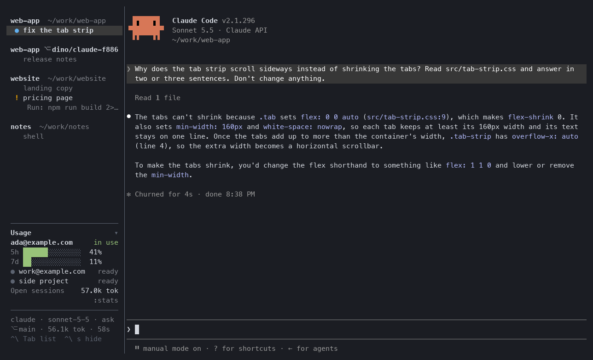
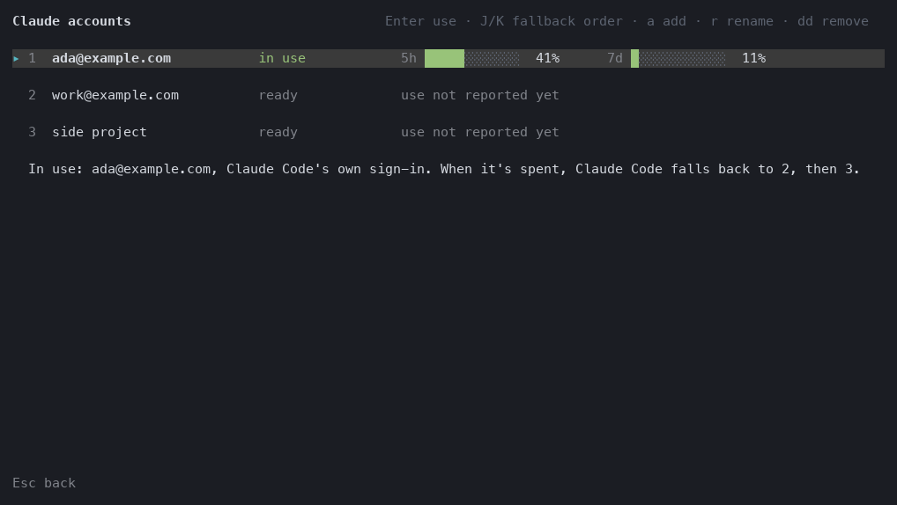
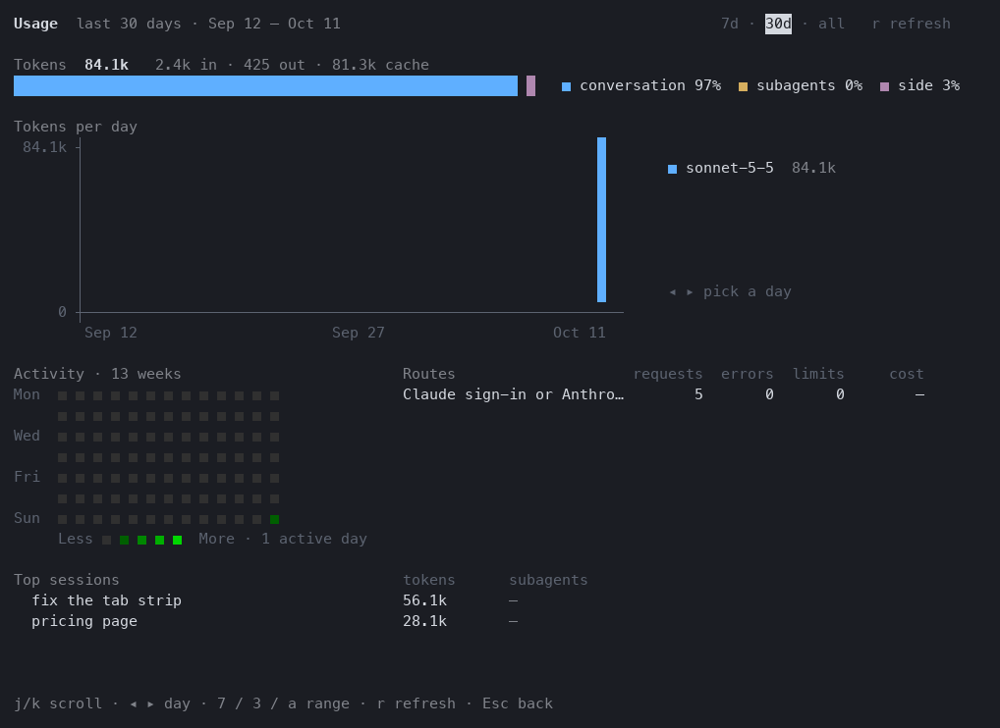

# dino-tui

A minimal, keyboard-only terminal client for [dino](https://github.com/meetdino/dino)'s dinod:
vim for agents. A list you move through with `j`/`k`, `Enter` to be inside an agent, one key to
get back. Everything real (sessions, accounts, worktrees, usage, settings) lives in dinod;
dino-tui shows it and sends requests. It runs on macOS and Linux, where it's dino's only UI.



```
website  ~/work/website
▴ ✓  landing copy       claude · opus · ask                    10.7k tok   2h
  ●  pricing page       claude · ask                                       52s
dino-app  ~/work/dino-app
  ⠋  fix the tab strip  claude · opus-4-5 · bypass             12.4k tok  now
  ✓  release notes      claude · sonnet-4-5 · plan              2.1M tok   3m

Enter attach · o new · : command · ? keys       ada@example.com 5h 42% · 1 needs you
```

## Use

It needs a running dinod from dino 0.1.11 or later (`dino daemon &`, or the Dino app, which
starts it); it never starts one itself. Then run `dino-tui`. The live rate needs 0.1.12's dinod,
and switching Claude accounts a newer one; with an older dinod those hide.

- `j`/`k`, `gg`/`G`, `Ctrl-d`/`Ctrl-u` move; `/` filters; `Enter` attaches.
- Attached in a terminal 100 columns or wider, the sessions are in a sidebar beside the agent, as
  in the app's window, with your usage at its foot. `Ctrl-\` then `Tab` puts the keyboard in it
  (`j`/`k`, `Enter`, `Esc`); `Ctrl-\` then `s` hides it, and the agent gets the whole terminal as
  it comes (and again brings it back; the choice is kept). Narrower, it's always the whole
  terminal.
- `Ctrl-\` then `d` comes back to the list, `n`/`p` go to the next or previous session, `N` to
  the next one that needs you. `Ctrl-\` twice sends it.
- `o` starts a session in the selected row's folder (`O`: in a new worktree), `i` sends a prompt
  without attaching, `m` picks mode, model and effort, `r` renames, `x` closes (`u` undoes).
- `A` lists your Claude accounts: `Enter` makes Claude Code use one, `J`/`K` order the rest.
  `:stats` shows usage; `:setup` is the first run's setup again (agents, accounts, sync, the
  default agent); `:settings` opens dinod's settings in `$EDITOR`. `?` lists every key.





Its own config is `~/.config/dino-tui/config.toml` (`:set` changes it): the prefix key,
`status_line`, `confirm_delete`, `sidebar` and `group_by` (`project` or `state`).
[docs/SPEC.md](docs/SPEC.md) is v1's contract, [docs/SPEC-v2.md](docs/SPEC-v2.md) what v2 changes.

## Build

```sh
cargo build --release   # target/release/dino-tui
```

On Linux, building needs SQLite's headers (`libsqlite3-dev`): dino-core links SQLite, though
dino-tui never calls it. [CONTRIBUTING.md](CONTRIBUTING.md) has the tests. MIT licensed.
